

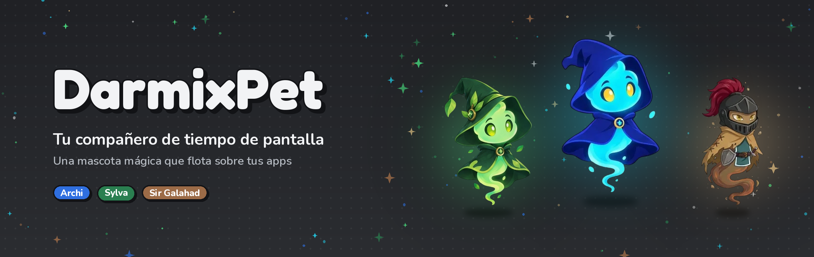

 
 

# DarmixPet

### Tu compañero de tiempo de pantalla

Una mascota mágica que flota sobre tus apps, cuida tu atención,
te avisa de lo importante y te recuerda que la vida también pasa fuera de la pantalla.

 

 

Página oficial también disponible en [English](https://darmixista.dev/en/darmixpet/)

 
 

[Novedades](#-novedades-en-v130) ·
[Características](#-características) ·
[Compañeros](#-tus-compañeros) ·
[Gestos](#-gestos) ·
[Instalación](#-instalación) ·
[Permisos](#-permisos-paso-a-paso) ·
[Privacidad](#-privacidad) ·
[Preguntas](#-preguntas-frecuentes)

---

## 🌟 Acerca de DarmixPet

**DarmixPet** es una app de bienestar digital para Android que te ayuda a recuperar el control sobre el tiempo que pasas en tu teléfono. En lugar de bloquearte con pantallas frías y avisos genéricos, pone a **una mascota flotante** sobre tus apps: te acompaña, te habla, te muestra tus notificaciones y te avisa cuando es momento de parar.

Cuando el tiempo de una app vigilada se agota, tu compañero te lleva suavemente al inicio con un mensaje cariñoso y activa un periodo de **descanso** antes de que puedas volver a usarla.

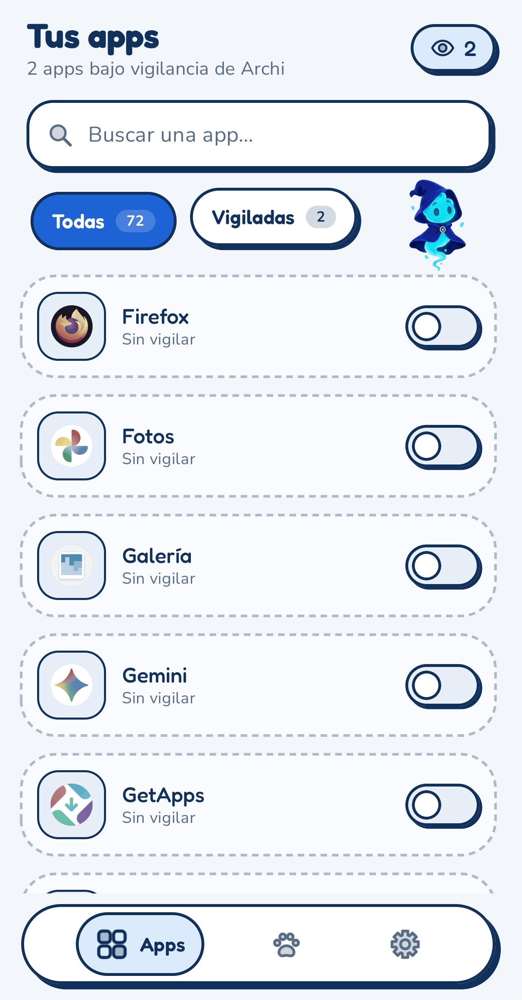
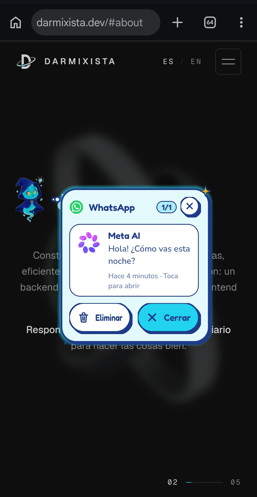
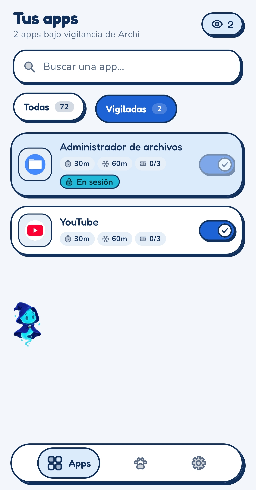

---

## 🆕 Novedades en v1.3.0

> [!TIP]
> **Notificaciones y un nuevo look.** Tu compañero ahora te ayuda con tus notificaciones, y la app se viste con los colores de tu personaje.

| | Novedad |
| :-: | --- |
| 🔔 | **Panel de notificaciones**: toca a tu mascota para leerlas, abrirlas o eliminarlas sin bajar la barra |
| 🔴 | **Aura de aviso**: un brillo rojo alrededor de tu mascota cuando tienes notificaciones pendientes |
| 💬 | **Avisos de mensajes por voz**: te dice cuando llega un mensaje de WhatsApp u otras apps que elijas |
| 🔇 | **Voz configurable**: silencia a tu mascota cuando quieras, sin perder sus avisos visuales |
| 🎨 | **Colores por personaje**: toda la app cambia de paleta según tu compañero, en claro y oscuro |
| ✨ | **Nuevo inicio animado** protagonizado por tu personaje, y un nuevo emblema |

Consulta todos los detalles en el [**CHANGELOG**](CHANGELOG.md).

---

## ✨ Características

<table>
<tr>
<td width="50%" valign="top">

### 🎯 Vigilancia inteligente
Elige qué apps vigilar y define el **tiempo por sesión**, el **descanso** entre sesiones y cuántas **sesiones al día** tienes. La detección es instantánea: si una app está en descanso, ni siquiera alcanzas a entrar.

</td>
<td width="50%" valign="top">

### 🪄 Mascota flotante
Tres personajes con personalidad propia, sprites animados, frases motivadoras y reacciones a tus gestos. Arrástrala a donde no estorbe; se acomoda sola al girar la pantalla.

</td>
</tr>
<tr>
<td width="50%" valign="top">

### 🔔 Tus notificaciones, a un toque
Un toque y tu mascota te muestra tus notificaciones una por una: léelas, ábrelas en su app o elimínalas. Un aura roja te avisa cuando hay algo pendiente.

</td>
<td width="50%" valign="top">

### 🗣️ Una mascota que habla
Te avisa en voz alta de la batería baja, la noche, tus límites de tiempo y los mensajes de las apps que elijas. Respeta el modo silencio, No molestar y tus llamadas.

</td>
</tr>
<tr>
<td width="50%" valign="top">

### ⚡ Menú rápido
Mantén presionada a tu mascota para controlar brillo, volumen, temporizador, cambiar de personaje o abrir la app, sin salir de lo que estás haciendo.

</td>
<td width="50%" valign="top">

### 🔋 Avisos contextuales
Reacciona sola cuando tu batería está baja, cuando ya es muy tarde o cuando estás escuchando música.

</td>
</tr>
<tr>
<td width="50%" valign="top">

### 🎨 Diseño tipo sticker
Contornos gruesos, sombras sólidas, tipografía redondeada (Fredoka + Nunito) y una paleta propia para cada personaje que se aplica a toda la app.

</td>
<td width="50%" valign="top">

### 🔄 Siempre al día
DarmixPet te avisa cuando hay una versión nueva, te muestra las novedades y la descarga e instala desde la propia app.

</td>
</tr>
</table>

---

## 🎭 Tus compañeros

Tres almas para tres formas de cuidarte. Elige la tuya desde la pantalla **Mascota**: la app, el inicio animado, los avisos y el menú rápido cambian de estilo contigo.

<table>
<tr>
<td align="center" width="33%">
 
<h3>Archi el Archimago</h3>
Éter · Magia Arcana  
<em>"Respira. Yo me encargo del ruido."</em>  
Analítico, sereno y enfocado
</td>
<td align="center" width="33%">
 
<h3>Sylva el Sabio</h3>
Naturaleza · Vitalidad  
<em>"Todo lo bueno crece con calma."</em>  
Paciente, alegre y reconfortante
</td>
<td align="center" width="33%">
 
<h3>Sir Galahad el Guardián</h3>
Tierra · Disciplina  
<em>"Tu tiempo es tu tesoro. Yo lo defiendo."</em>  
Valiente, firme y leal
</td>
</tr>
</table>

---

## 👆 Gestos

| Gesto | Qué hace |
| --- | --- |
| **1 toque** | Te muestra tus notificaciones. Si no tienes, te dice una frase para animarte |
| **2 toques** | Hace una reacción divertida |
| **3 toques** | Reacción especial y enciende o apaga la **linterna** |
| **Mantener presionada** | Abre el **menú rápido** |
| **Arrastrar** | La mueves a donde no estorbe; se queda donde la sueltes |

> [!NOTE]
> Toda la guía también está dentro de la app, en **Ajustes → Cómo jugar con tu mascota**, con animaciones de cada gesto.

---

## 🎬 Cómo se ve

**Interacciones y notificaciones**

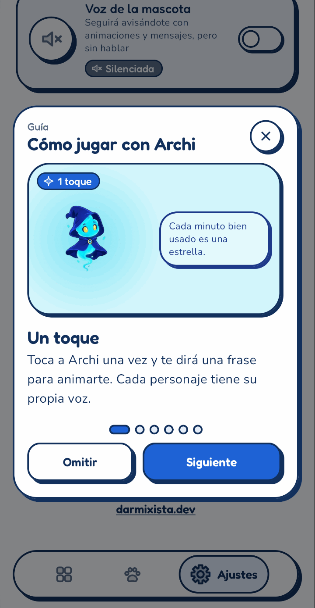
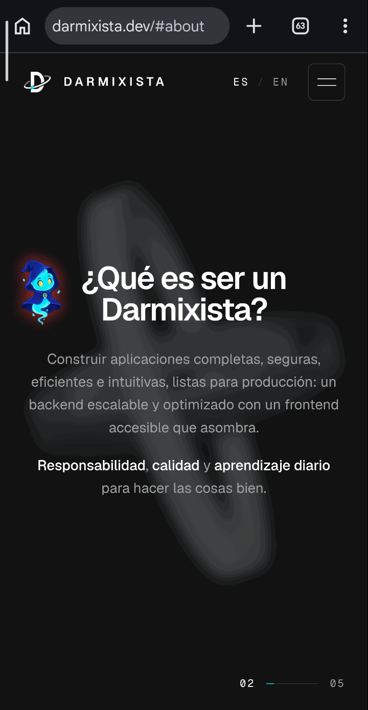

  

**Inicio animado y bloqueo de app**

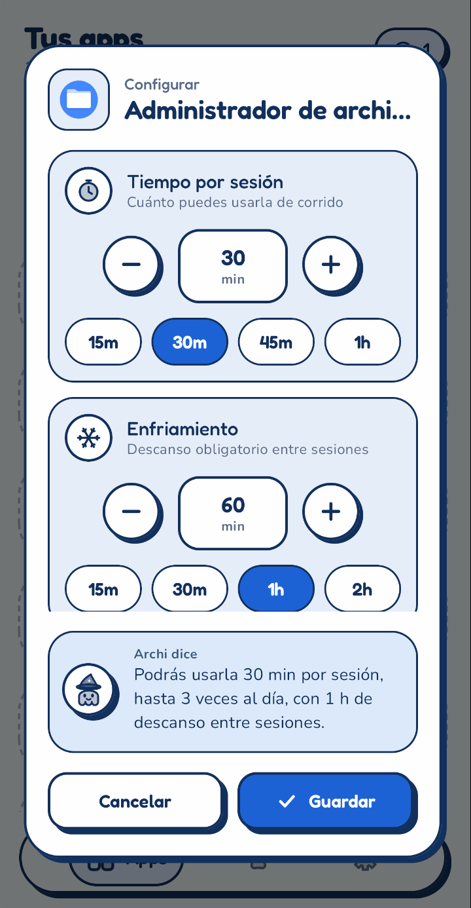

---

## ⚙️ Cómo funciona

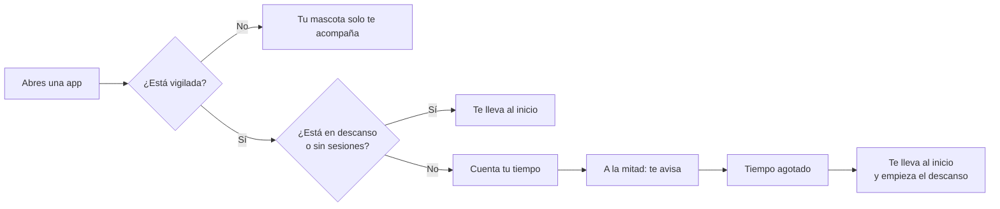

---

## 🚀 Instalación

### Requisitos

| Requisito | Valor |
| --- | --- |
| **Android** | 8.0 Oreo (API 26) o superior |
| **Arquitectura** | Universal |
| **Espacio** | ~17 MB |
| **Permisos** | 7, más un paso previo en Android 13+ ([detalle](#-permisos-paso-a-paso)) |

### Pasos

1. Descarga el **APK** desde la [página oficial](https://darmixista.dev/darmixpet/) o desde la [última release](../../releases/latest).
2. Ábrelo desde tu gestor de archivos.
3. Si Android lo pide, **autoriza la instalación desde esta fuente**.
4. Abre DarmixPet y **completa la pantalla de permisos**: la app te muestra los pasos antes de abrir cada ajuste.
5. Elige a tu compañero y empieza a cuidar tu tiempo.

> [!TIP]
> ¿Estás en la computadora? Abre la [página oficial](https://darmixista.dev/darmixpet/) y escanea el código QR con tu teléfono para descargarlo ahí directamente.

> [!IMPORTANT]
> DarmixPet **no está en Google Play**: se distribuye como APK directo. Por eso Android pide un paso extra para algunos permisos. Las actualizaciones llegan desde la propia app.

---

## 🔐 Permisos paso a paso

DarmixPet te guía en cada permiso dentro de la app. Aquí tienes el detalle para que sepas qué esperar y **para qué se usa cada uno**.

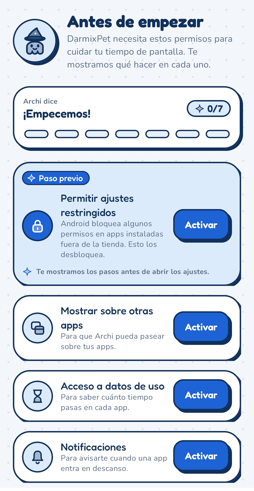

| # | Permiso | Para qué sirve |
| :-: | --- | --- |
| 0 | **Permitir ajustes restringidos** | Paso previo que desbloquea los demás (solo Android 13+ fuera de Google Play) |
| 1 | **Mostrar sobre otras apps** | Que tu mascota flote sobre el resto de apps |
| 2 | **Acceso a datos de uso** | Medir cuánto tiempo pasas en cada app |
| 3 | **Notificaciones** | Avisarte de los descansos y mantener viva a tu mascota |
| 4 | **Leer notificaciones** | Mostrarte tus notificaciones con un toque y avisarte de mensajes |
| 5 | **Ignorar optimización de batería** | Que tu mascota no se cierre sola |
| 6 | **Detección instantánea** (Accesibilidad) | Saber al instante qué app abres |
| 7 | **Modificar ajustes del sistema** | Ajustar el brillo desde el menú rápido |

<b>0️⃣ Permitir ajustes restringidos</b>

 

> [!WARNING]
> Solo aparece si instalaste desde fuera de Google Play y tienes **Android 13 o superior**.

| Paso | Acción |
| :-: | --- |
| 1 | Se abrirá **Información de la app** de DarmixPet |
| 2 | Toca el menú **⋮** (arriba a la derecha) y elige **Permitir ajustes restringidos** |
| 3 | Confirma con huella, PIN o patrón si te lo pide |
| 4 | Vuelve a DarmixPet y toca **"Ya lo hice"** |

💡 **¿No ves la opción?** Android a veces solo la muestra después de intentar activar un permiso bloqueado. Prueba primero con **Acceso a datos de uso**: saldrá un aviso, tócalo, acepta y regresa a la información de la app.

<b>1️⃣ Mostrar sobre otras apps</b>

 

| Paso | Acción |
| :-: | --- |
| 1 | Se abrirá la pantalla de DarmixPet |
| 2 | Activa **"Permitir mostrar sobre otras apps"** |
| 3 | Vuelve con el botón **Atrás** |

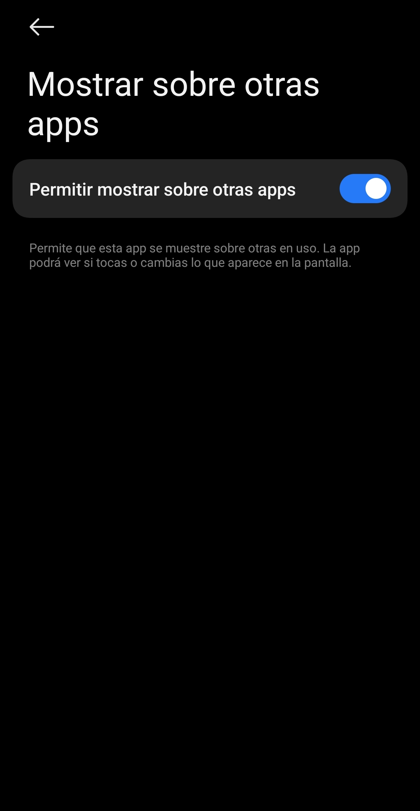

<b>2️⃣ Acceso a datos de uso</b>

 

| Paso | Acción |
| :-: | --- |
| 1 | Se abrirá la pantalla de DarmixPet. Si ves una lista, busca **DarmixPet** y tócalo |
| 2 | Activa **"Permitir acceso al uso"** |
| 3 | Si aparece un aviso de seguridad, léelo y acepta |
| 4 | Vuelve a DarmixPet |

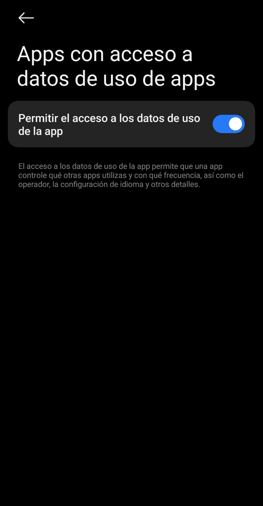

<b>3️⃣ Notificaciones</b>

 

- **Primera vez**: Android muestra un diálogo. Toca **Permitir**.
- **Si lo rechazaste antes**: se abrirán los ajustes de notificaciones de DarmixPet. Activa **Permitir notificaciones** y vuelve.

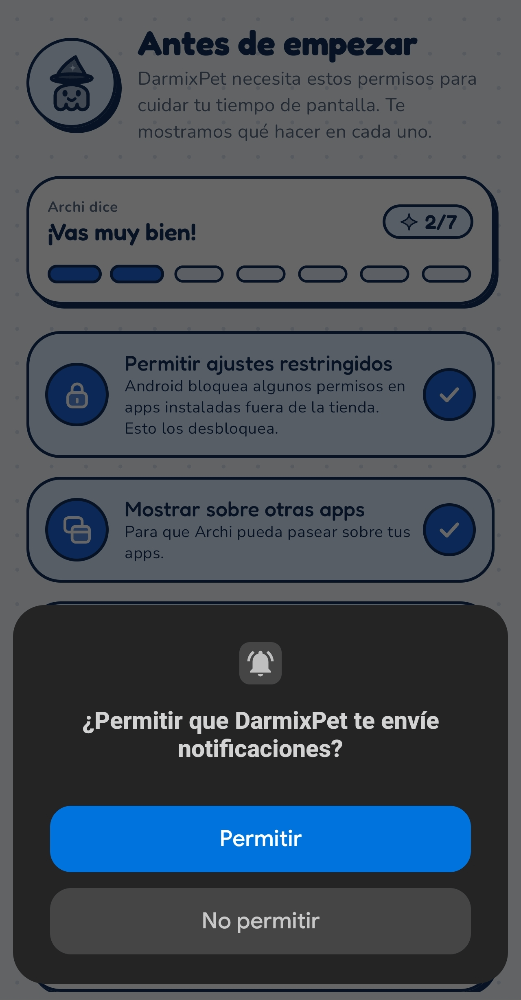

<b>4️⃣ Leer notificaciones</b>

 

| Paso | Acción |
| :-: | --- |
| 1 | Se abrirá **Acceso a notificaciones**. Si ves una lista, busca **DarmixPet** y tócalo |
| 2 | Activa **"Permitir acceso a notificaciones"** |
| 3 | Android te mostrará lo que la app podrá leer. Toca **Permitir** |
| 4 | Vuelve a DarmixPet |

🔒 DarmixPet solo lee tus notificaciones para mostrártelas en tu mascota y avisarte de mensajes. **No las guarda ni las envía a ningún lado.**

💡 Según la marca, también puede estar en **Acceso especial**, **Privacidad** o **Notificaciones → Configuración avanzada**.

<b>5️⃣ Ignorar optimización de batería</b>

 

| Paso | Acción |
| :-: | --- |
| 1 | Se abrirá la configuración de batería de DarmixPet |
| 2 | Elige **Sin restricciones** (o **No optimizar** / **Permitir**) |
| 3 | Vuelve a DarmixPet |

💡 En Xiaomi, Huawei y otras marcas conviene activar también **Inicio automático** para DarmixPet desde los ajustes de la marca.

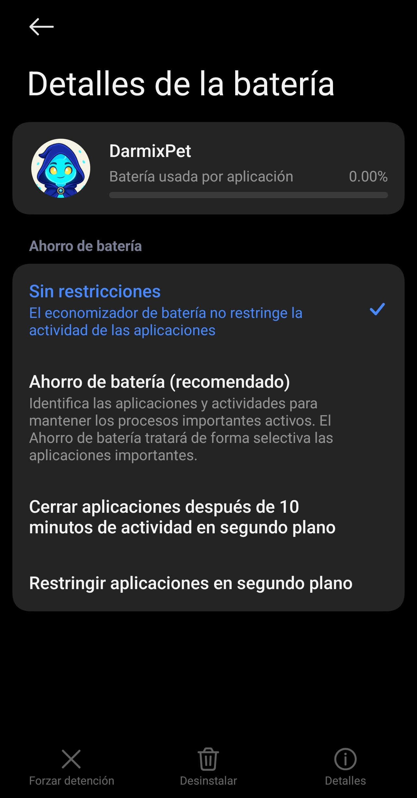

<b>6️⃣ Detección instantánea (Accesibilidad)</b>

 

| Paso | Acción |
| :-: | --- |
| 1 | Se abrirá Accesibilidad |
| 2 | Entra a **Apps descargadas** (o **Servicios instalados**) y toca DarmixPet |
| 3 | Activa **Usar DarmixPet** |
| 4 | Acepta el aviso de seguridad (en algunos teléfonos el botón tarda unos segundos en habilitarse) |
| 5 | Vuelve a DarmixPet |

🔒 DarmixPet **solo lo usa para saber qué app está abierta**. No lee lo que escribes, tus mensajes ni tus contraseñas.

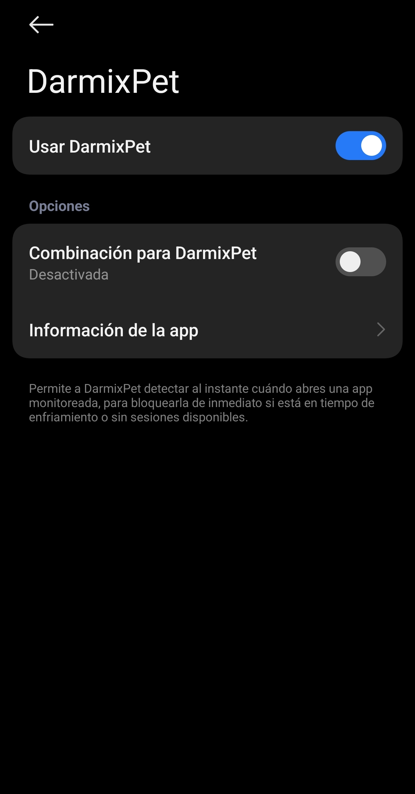

<b>7️⃣ Modificar ajustes del sistema</b>

 

| Paso | Acción |
| :-: | --- |
| 1 | Se abrirá la pantalla de DarmixPet |
| 2 | Activa **"Permitir modificar los ajustes del sistema"** |
| 3 | Vuelve a DarmixPet |

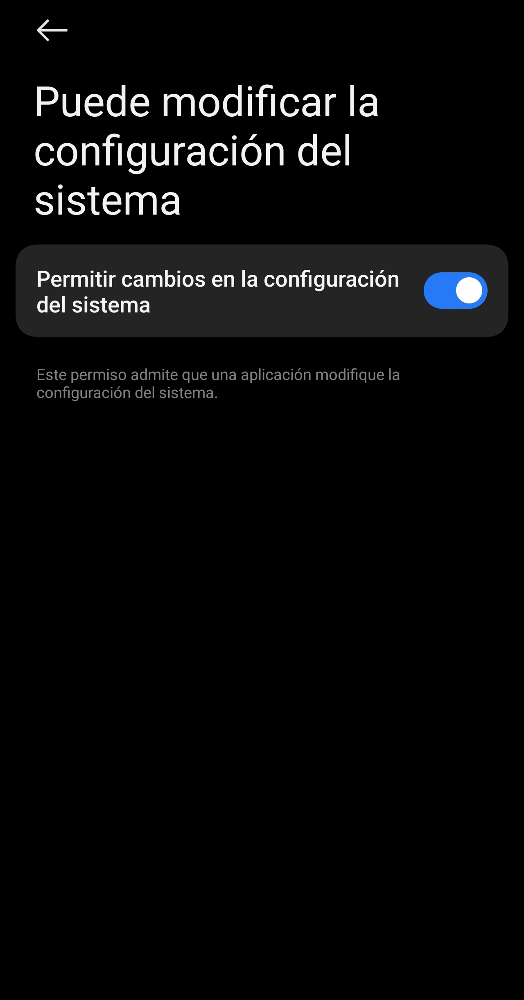

### ℹ️ Sobre el aviso "se muestra sobre otras apps"

> [!NOTE]
> Android muestra un aviso **"DarmixPet se muestra sobre otras apps"** siempre que una app flota sobre el resto. **Lo pone el sistema**, no la app, y no afecta su funcionamiento. Puedes ocultarlo siguiendo la guía en **Ajustes → Aviso «se muestra sobre otras apps»**.

> [!CAUTION]
> **No desactives la notificación "DarmixPet activo"**: es la que mantiene viva a tu mascota en segundo plano.

---

## 🔒 Privacidad

**DarmixPet funciona en tu teléfono, no en la nube.**

| | |
| :-: | --- |
| ✅ | Tus apps vigiladas, tiempos y ajustes se guardan **solo en tu teléfono** |
| ✅ | Tus notificaciones se leen para mostrártelas y **nunca se guardan ni se envían** |
| ✅ | Los avisos de mensajes dicen **solo la app** (decir quién escribe es opcional y viene apagado) |
| ✅ | Borras todos tus datos con solo desinstalar la app |
| ❌ | Sin cuentas de usuario |
| ❌ | Sin anuncios |
| ❌ | Sin rastreo ni telemetría |

> [!NOTE]
> La única conexión a internet que hace DarmixPet es para **buscar actualizaciones** en las releases públicas de este repositorio.

---

## ❓ Preguntas frecuentes

<b>¿Por qué no está en Google Play?</b>

 

DarmixPet es un proyecto personal que se distribuye de forma directa y gratuita. Por eso Android pide el paso de **ajustes restringidos** en Android 13 o superior. Las actualizaciones llegan desde la propia app.

<b>¿Gasta mucha batería?</b>

 

No. La mascota solo revisa la app abierta mientras la pantalla está encendida, y pausa casi todo con la pantalla apagada. Si quieres un descanso total, puedes **dormir a tu mascota** desde Ajustes o desde su menú rápido.

<b>¿Lee mis mensajes?</b>

 

Solo para mostrarte tus notificaciones cuando tú tocas a tu mascota, y para avisarte de que llegó un mensaje. No guarda nada ni lo envía a ningún lado.

<b>¿Puedo silenciar a mi mascota?</b>

 

Sí. En **Ajustes → Voz de la mascota** puedes apagar su voz por completo, o elegir de qué apps quieres avisos de mensajes. Además, nunca habla con el teléfono en silencio, en vibración o durante una llamada.

<b>¿Cómo actualizo la app?</b>

 

Cuando hay una versión nueva, DarmixPet te muestra un aviso con las novedades. Toca **Descargar** y luego **Instalar**: se instala encima sin perder tus ajustes. También aparece un aviso al inicio de **Ajustes**.

---

## 🛠️ Stack técnico

<table>
<tr>
<td valign="top" width="50%">

**Lenguaje y UI**
- Kotlin `2.x`
- Jetpack Compose · Material 3
- Paletas dinámicas por personaje con transición animada
- Compose Canvas para íconos, emblema y animaciones
- Edge-to-edge

</td>
<td valign="top" width="50%">

**Servicios del sistema**
- `LifecycleService` para la mascota flotante
- `AccessibilityService` para detección instantánea
- `NotificationListenerService` para el panel de notificaciones
- `UsageStatsManager` · `WindowManager`
- `TextToSpeech` para la voz

</td>
</tr>
<tr>
<td valign="top" width="50%">

**Datos**
- Room (SQLite) para apps vigiladas
- SharedPreferences para preferencias
- Corrutinas + `Flow` / `StateFlow`

</td>
<td valign="top" width="50%">

**Distribución**
- APK firmado en GitHub Releases
- Actualizaciones dentro de la app
- Página oficial en [darmixista.dev](https://darmixista.dev/darmixpet/)

</td>
</tr>
</table>

---

## 🐛 Reportar problemas y sugerencias

¿Encontraste un bug? ¿Se te ocurre una mejora o una frase nueva para algún personaje?

Abre un [**issue**](../../issues/new/choose) con:

- 📱 Modelo de teléfono y versión de Android
- 🎯 Versión de DarmixPet (aparece al final de **Ajustes**)
- 📝 Descripción clara del problema o idea
- 📸 Captura o video si aplica

---

## 📄 Licencia

DarmixPet es un proyecto de **código cerrado y uso personal**. Todos los derechos reservados © 2026 Darmix.

La descarga y el uso personal de la aplicación están permitidos. No se permite la redistribución, modificación o uso comercial sin autorización expresa del autor.
Consulta el archivo [LICENSE](LICENSE) para ver los términos completos.

---

## 📜 Historial de versiones

| Versión | Fecha | Resumen |
| --- | --- | --- |
| **v1.3.0** | 2026-10-29 | Panel de notificaciones, avisos de mensajes por voz, colores por personaje y nuevo inicio animado |

Consulta el [**CHANGELOG**](CHANGELOG.md) para ver el registro completo de todas las versiones.

---

**Hecho con 💜 por Darmix**

Si DarmixPet te ayuda a usar mejor tu tiempo, compártelo con quien lo necesite.

[Sitio oficial](https://darmixista.dev/darmixpet/) · [Changelog](CHANGELOG.md) · [Releases](../../releases) · [Reportar un bug](../../issues)

